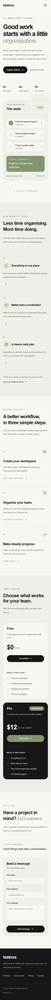

# Taskora – SaaS Landing Page

Taskora is a simple and modern task management platform concept designed to help individuals and teams organise their work, manage projects and track progress.

This project is a responsive SaaS landing page built as part of a frontend development assignment.

## Features

- Responsive navigation bar
- Hero section introducing Taskora
- Features section highlighting the main benefits
- How It Works section explaining the process
- Pricing section with Free and Pro plans
- Contact form with basic validation
- Success message after form submission
- Smooth scrolling and scroll animations
- Responsive design for desktop and mobile screens

## Technologies Used

- React.js
- Vite
- Tailwind CSS
- JavaScript
- Lucide React
- Motion for animations

## Getting Started

Follow these steps to run the project locally.

### 1. Clone the repository

```bash
git clone YOUR_GITHUB_REPOSITORY_URL
```

### 2. Open the project folder

```bash
cd taskora-saas-landing-page
```

### 3. Install dependencies

```bash
npm install
```

### 4. Start the development server

```bash
npm run dev
```

Open the local URL shown in your terminal to view the website.

## Screenshots

### Desktop View


### Mobile View



## Contact Form

The contact form includes basic frontend validation and displays a success message after submission. It is a demonstration form and is not connected to a backend or email service.

## Pricing

The landing page displays two sample plans:

- Free Plan – $0
- Pro Plan – $12 per user/month

These are demonstration prices. No payment system is connected.

## Author

Frontend Development Assignment
